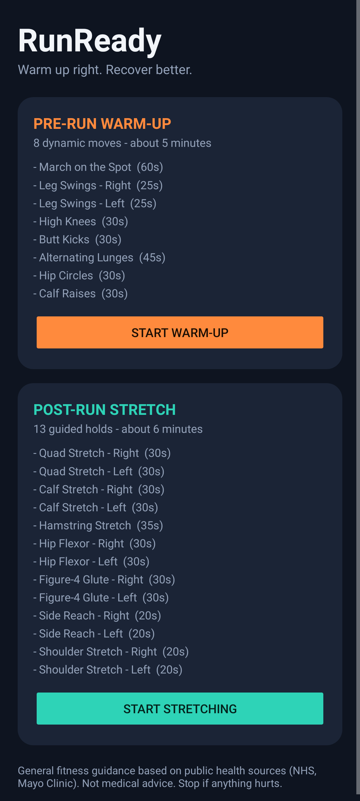
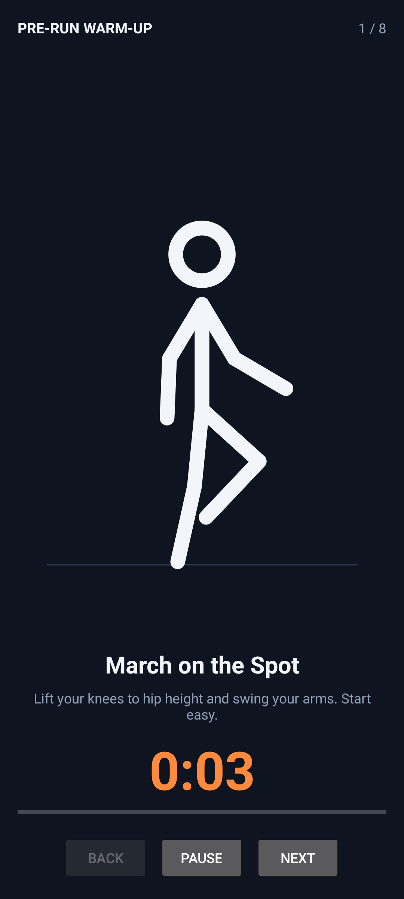
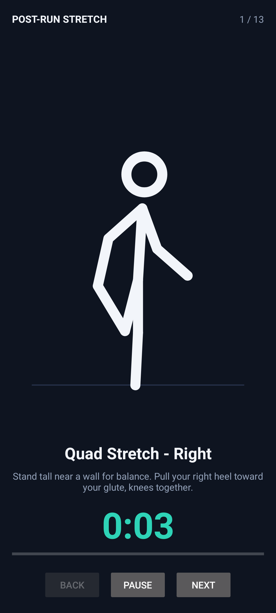
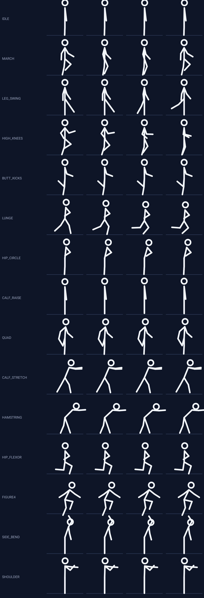

# RunReady

**Warm up right. Recover better.** A tiny Android app that guides runners through a pre-run warm-up and a post-run stretch with animated exercise demos and automatic timers. No account, no ads, no tracking, and it works fully offline.

## Download

**[Download RunReady.apk - v1.0.0 (25 KB)](https://github.com/runreadyapp/runready/releases/download/v1.0.0/RunReady.apk)**

Requires Android 7.0 or newer. All releases are on the [Releases page](https://github.com/runreadyapp/runready/releases).

### Installing

1. Open the download link on your Android phone.
2. Android will ask you to allow installs from your browser (Settings > Install unknown apps). This prompt is normal for any app installed outside an app store.
3. Open the downloaded file and tap Install.

The app requests **no Android permissions at all**: no internet, no storage, no location. It runs entirely on your phone.

## Screenshots

| Home | Warm-up session | Stretch session |
| --- | --- | --- |
|  |  |  |

Every exercise is animated by the app's own pose engine rather than video. The full pose sheet for every animation:

*These screenshots are rendered by the app's real drawing code through the Android framework test harness (Robolectric) on a desktop, not captured from a physical phone. See Testing status.*

## Features (v1.0.0)

- **Pre-run warm-up:** 8 dynamic moves, about 5 minutes, to raise your pulse and loosen joints before running.
- **Post-run stretch:** 13 guided static holds, about 6 minutes, for calves, quads, hamstrings, hips and shoulders after running.
- Animated demo for every exercise, with a per-move countdown timer, a 3-second get-ready phase and a session progress bar.
- Pause/resume and skip forward/back at any time; progress survives rotating the phone.
- No sign-up, no ads, no analytics, no network use. The whole app is a 25 KB download.

## The routines

### Pre-run warm-up (dynamic)

1. March on the Spot (60s)
2. Leg Swings - Right (25s)
3. Leg Swings - Left (25s)
4. High Knees (30s)
5. Butt Kicks (30s)
6. Alternating Lunges (45s)
7. Hip Circles (30s)
8. Calf Raises (30s)

### Post-run stretch (static holds)

1. Quad Stretch - Right (30s)
2. Quad Stretch - Left (30s)
3. Calf Stretch - Right (30s)
4. Calf Stretch - Left (30s)
5. Hamstring Stretch (35s)
6. Hip Flexor - Right (30s)
7. Hip Flexor - Left (30s)
8. Figure-4 Glute - Right (30s)
9. Figure-4 Glute - Left (30s)
10. Side Reach - Right (20s)
11. Side Reach - Left (20s)
12. Shoulder Stretch - Right (20s)
13. Shoulder Stretch - Left (20s)

## Tech notes

- Native Android written in plain Java, built directly with the Android SDK command-line tools (aapt2, javac, d8, zipalign, apksigner) - no Gradle, no third-party libraries.
- minSdk 24 (Android 7.0), targetSdk 34.
- Exercises are parametric 2D poses rendered with the Canvas API, which is why the APK is only about 25 KB.
- The source code is not currently published.

## Testing status

- Session behavior (timers, navigation, pause/resume, screen rotation) is covered by automated tests running the app's real activities through the Android framework on desktop.
- The v1.0.0 APK download link is verified reachable from a signed-out browser.
- **The app has not yet been installed or run on a physical device or emulator.** Treat v1.0.0 as a test build and report anything odd.

## In development (not yet released)

Version 1.1 is in progress and is **not** part of the downloadable APK yet:

- Original illustrated character animations replacing the stick figure.
- Routines replaced with the app owner's own warm-up and post-run lists: rep counters for rep-based moves, per-side timed holds, and a walk-first cool-down step.

## Exercise sources

Routine design and form cues draw on public health guidance:

- [NHS - How to warm up before exercising](https://www.nhs.uk/live-well/exercise/how-to-warm-up-before-exercising/)
- [Bupa - Running: warm up and cool down exercises](https://www.bupa.co.uk/newsroom/ourviews/running-exercises)
- [Mayo Clinic - A guide to basic stretches](https://www.mayoclinic.org/healthy-lifestyle/fitness/in-depth/stretching/art-20546848)
- [Healthline - Essential Stretches for Runners](https://www.healthline.com/health/fitness-exercise/essential-runner-stretches)

## Disclaimer

General fitness guidance only, not medical advice or treatment. Stop if anything hurts, and talk to a healthcare professional about pain or injury.
